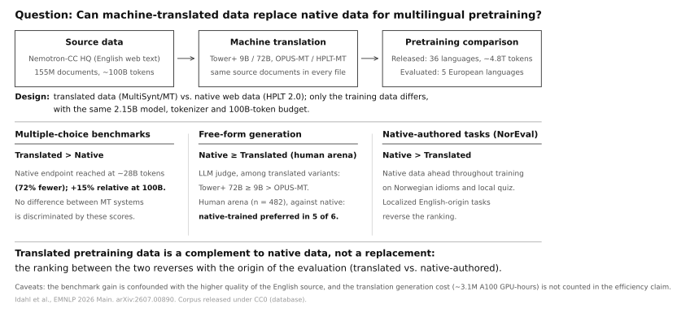

## The question

For most languages, there is not enough native web text to pretrain a large language model. A tempting workaround is to translate high-quality English data at scale and train on the translations. This paper asks the question directly: **can machine-translated pretraining data replace native data — and how would we even know, given that most benchmarks are themselves translated from English?**

To answer it, the authors build MultiSynt/MT, a corpus of about 4.8 trillion target-language tokens across 36 languages, produced by translating 100 billion high-quality Nemotron-CC tokens with Tower+ and OPUS-MT/HPLT-MT systems, and train reference models where only the pretraining data differs: translated data versus native web data (HPLT 2.0), with the same 2.15B model, tokenizer and 100B-token budget.

## What they find

- **On standard benchmarks, translated data wins clearly.** Averaged over five European languages, the translated-data model reaches the native model's final score at about 28B tokens (about 72% fewer) and ends about 15% relatively higher at 100B tokens (Figure 2).
- **The benchmarks cannot see translation quality.** OPUS-MT, Tower+ 9B and Tower+ 72B produce nearly indistinguishable benchmark curves, even though human evaluation ranks their translations differently. When models are compared on free-form generation with an LLM judge instead, the expected ranking reappears (Tower+ 72B ≥ 9B > OPUS-MT).
- **In a human arena, native data wins.** Raters comparing model continuations preferred the native-trained model in five of six languages — although the evidence is preliminary: 482 judgments in total, unevenly spread (243 for Swedish, 20 for Spanish).
- **Within one language, the ranking reverses with the task's origin.** In Norwegian, native data stays ahead throughout training on idioms and a public broadcaster's quiz, while localized versions of English-origin tasks favor translated data at later checkpoints.

There are honest limits. The headline comparison also changes the source corpus and its quality filtering, so the gain may reflect the quality of the English source rather than translation itself — the authors say this themselves. The efficiency claim counts training tokens only, not the roughly 3.1M A100 GPU-hours spent generating the translations. Each configuration was trained once, and the comparison is verified on five European languages; the 36 languages contain no Southeast Asian language.

## Our take

The finding I keep coming back to is the reversal in Norwegian. It suggests that a benchmark score is never just a property of the training data: **it is jointly a property of the data and of where the evaluation came from.** A suite built from translated English tasks measures, in part, how well a model handles translated-origin content — which is exactly what translated training data teaches.

There is also an asymmetry worth noting. The source-quality confound works *in favor* of the translated side: the translated models trained on cleaner, filtered English text. That weakens the headline gain, but it makes the native wins on native-authored tasks stronger evidence, not weaker — native data won despite the comparison being stacked against it.

So the practical reading is not "translated data works" or "it doesn't". Translated data looks like a complement that raises the floor on translated-origin competence, while native-authored evaluation remains the only way to see what it cannot teach.

## What I want to know next

My own interest is Khmer, which is not among the 36 languages and has far less native text and weaker machine translation than any language verified here. The order of operations this paper suggests is:

> **Build the small native-origin evaluation first; only then scale translated data.**

Without a native-authored yardstick, adding translated data would leave us unable to tell real improvement from improvement on translated-origin tests. A minimal native evaluation set — idioms, local knowledge, register and spelling, written by native speakers for native speakers — is unglamorous work, but this paper makes a strong case that it has to come first.
