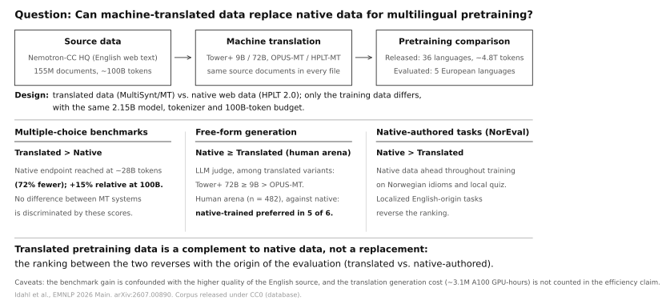

## どんな問いか

多くの言語では、大規模言語モデルの事前学習に足るネイティブなWebテキストが存在しません。そこで考えたくなるのが、高品質な英語データを大規模に翻訳し、その翻訳で学習するという方法です。この論文はその問いを正面から扱います。**機械翻訳された事前学習データは、ネイティブデータの代わりになるのか。そして、ベンチマーク自体の多くが英語からの翻訳である以上、その答えをどうやって確かめればよいのか。**

著者らはまず MultiSynt/MT というコーパスを構築しました。高品質な Nemotron-CC の1,000億トークンを Tower+ と OPUS-MT/HPLT-MT で翻訳し、36言語・約4.8兆トークンの対象言語データを用意します。そのうえで、2.15Bモデル・トークナイザ・100Bトークンの予算を同一にし、学習データだけを翻訳データとネイティブWebデータ（HPLT 2.0）で入れ替えた統制比較を行いました。

## Findings

- **標準ベンチマークでは、翻訳データが明確に勝ちます。** 欧州5言語の平均で、翻訳データのモデルは約28Bトークン（約72%少ない量）でネイティブモデルの最終スコアに到達し、100Bトークン時点では約15%相対的に上回ります（Figure 2）。
- **ただしベンチマークには翻訳の品質が見えていません。** OPUS-MT、Tower+ 9B、Tower+ 72B の学習曲線はほぼ重なりますが、人手評価では翻訳品質に順位があります。自由生成をLLMジャッジで比べると、その順位（Tower+ 72B ≥ 9B > OPUS-MT）が回復します。
- **人間のアリーナ評価では、ネイティブが勝ちます。** モデルの続き文を比較した評価者は、6言語中5言語でネイティブ学習モデルを選びました。ただし根拠は予備的で、判定は計482件、配分もスウェーデン語243件に対してスペイン語20件と偏っています。
- **同じ言語の中でも、タスクの出自で順位が反転します。** ノルウェー語では、慣用句と公共放送のクイズでネイティブデータが訓練を通して優位を保つ一方、英語由来タスクのローカライズ版では後半のチェックポイントで翻訳データが上回ります。

限界も率直に書かれています。主比較では原文コーパスとその品質フィルタリングも同時に変わるため、改善は「翻訳」ではなく英語原文の品質による可能性がある、と著者ら自身が述べています。「72%効率化」は学習トークンだけの話で、翻訳生成に使った約310万 A100 GPU時は数えていません。各条件の学習は1回のみで、比較が検証されたのは欧州5言語です。36言語の中に東南アジアの言語は含まれていません。

## 私たちのコメント

私が一番引っかかったのは、ノルウェー語での反転です。ベンチマークのスコアは学習データだけの性質ではない、ということを示しています。**スコアは、データと「評価がどこから来たか」の両方で決まります。** 英語タスクの翻訳で作られた評価群は、ある意味で「翻訳由来の内容をどれだけ扱えるか」を測っていて、それはまさに翻訳データが教えることと重なります。

帰属の非対称性も重要だと思います。原文品質の交絡は、翻訳側に有利に働きます。きれいにフィルタされた英語で学習しているからです。これは主結果の数字を弱めますが、同時に、ネイティブ由来タスクでのネイティブの勝利をより強い証拠にします。不利な条件で勝っているからです。

したがって実務的な読みは、「翻訳データは使える／使えない」ではありません。翻訳データは翻訳由来の能力の底上げをする補完であり、それが教えられないものを見るには、ネイティブ由来の評価が依然として必要だ、ということです。

## 次に知りたいこと

私自身の関心はクメール語にあります。36言語には含まれず、ここで検証されたどの言語よりもネイティブテキストが少なく、機械翻訳も弱い言語です。この論文が示唆する順序はこうなります。

> **まず小さなネイティブ由来の評価を作る。それから翻訳データを増やす。**

ネイティブの物差しがなければ、翻訳データを足しても、本当の改善なのか翻訳由来テストでの改善なのか区別できません。慣用句、地域の知識、レジスターや綴りなど、母語話者が母語話者のために書いた小さな評価セットは地味な仕事ですが、この論文を読むと、それを先にやるべき理由がかなり強く感じられます。
