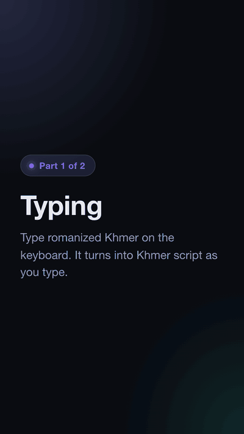

## Khmer, typed in Latin letters

Khmer has its own script, yet many Cambodians chat in Khmer typed with Latin letters. The habit spread when few phones could type Khmer script, and it is still common on phones and social media. It is quick to type on any keyboard, but it has no standard spelling: `knhom`, `khnhom`, `kyom` and just `nh` all mean ខ្ញុំ ("I"). People drop vowels, glue or split words, and mix in English: `ot mean wifi te` is អត់មាន wifi ទេ.

Messages written this way are hard to read, and tools built for Khmer script, from word segmenters to search, cannot process them. Mainstream input tools don't help either: Gboard has transliteration layouts for Lao and Sinhala, but none for Khmer.

A converter from romanized Khmer to Khmer script has two uses. Inside a keyboard, it turns what people already type into Khmer script, offline and within milliseconds. Outside a keyboard, it shows someone else's romanized message in Khmer script. Samdei Type does both with one small model:

<figure class="phone">
  
  <figcaption>Samdei Type Mini converts one message as it is typed, and again when a friend sends it in Latin letters. Every conversion shown is a real output of the released model.</figcaption>
</figure>

## The idea: separate what is written from how it is spelled

To learn this, a model needs pairs of romanized text and Khmer script. Such pairs are scarce, even though Khmer-script text is plentiful. The open models I found learn their spellings mainly from one source each, a word list or a rule-based generator, and inherit that source's habits.

So I split a training pair into its two halves. The Khmer side, *what is written*, is always a real sentence, so the target is correct by construction. The Latin side, *how it is spelled*, comes from several small and imperfect sources, each biased in its own way, so the model does not learn just one source's habits. Here is one sentence, ខ្ញុំចង់ទៅផ្សារ ("I want to go to the market"), spelled by different sources:

| Romanized spelling | Source |
| --- | --- |
| `knhom jong tou bsa` | persona generator, careful typist |
| `khnhom chong tov phsear` | spelling table mined from a public word list |
| `kyom jong tow phsar` | persona generator, mixed habits |
| `nh jg tv psa` | persona generator, lazy typist |

The sources are:

- a rule-based generator that spells like four typing personas and adds noise such as dropped vowels, glued words and typos;
- spelling tables mined from public lists of romanized Khmer words;
- romanizations of real sentences written by an LLM (Gemma 4, run locally);
- abbreviated copies (`tov` → `tv`) and stretched letters (`tovvv`) for casual chat.

## Training: from broad to specific

A small character-level Transformer is first pretrained on mostly generator-made pairs (12.8M pairs for Base, 6.5M for Mini). Two short stages then bring in the other sources: chat-like pairs, then casual register. Pretraining teaches words; the chat-like stage is what teaches whole sentences. Training took about 3 hours for Mini and 6 hours for Base, on one laptop GPU.

At decoding time, the beam-search candidates are reranked with a word language model. Base also uses a character language model and a reverse model, which checks that a candidate explains all of the input.

## A benchmark of everyday messages

There was no public test set of everyday romanized messages: the open models were tested on held-out parts of their own training source, and the real-chat tests I knew of had fewer than 40 sentences. So I built **Samdei Type Bench**: 2,155 everyday messages and words over designed scenes, mostly LLM drafts audited by native speakers, whom I thank for their reviews. No Samdei Type model was trained, selected or tuned on it.

On it, both models beat the best existing open model. Lower character error rate (CER) is better:

| System | Parameters | CER | Exact match |
| --- | --- | --- | --- |
| **Samdei Type Base** | 18.2M | **0.052** | **30%** |
| **Samdei Type Mini** | 7.1M | 0.058 | 24% |
| Akkhara-mini, in 6-word pieces | 17.8M | 0.066 | 23% |
| AkaraAlpha | 0.08M | 0.281 | 2% |

Mini is also fast. As int8 ONNX on one CPU thread of an Apple M5 Pro, it takes about 5 ms per input, or 5.7 ms per keystroke with reranking.

## What is released

Everything is open, in one [Hugging Face collection](https://huggingface.co/collections/samdei/samdei-type-romanized-khmer-khmer-script), with the inference code on [GitHub](https://github.com/Samdei-Labs/samdei-type):

| Release | What it is | License |
| --- | --- | --- |
| [samdei-type-mini](https://huggingface.co/samdei/samdei-type-mini) | On-device model: 7 MiB as int8 ONNX, plus a 1.2 MiB word LM | Apache-2.0 |
| [samdei-type-base](https://huggingface.co/samdei/samdei-type-base) | The most accurate open model, with its reranking models | Apache-2.0 |
| [mini-pretrained](https://huggingface.co/samdei/samdei-type-mini-pretrained), [base-pretrained](https://huggingface.co/samdei/samdei-type-base-pretrained) | Pretrained checkpoints, to fine-tune your own converter | Apache-2.0 |
| [samdei-type-bench](https://huggingface.co/datasets/samdei/samdei-type-bench) | Samdei Type Bench, with human-checked Khmer | CC BY 4.0 |
| [pretraining-data](https://huggingface.co/datasets/samdei/samdei-type-pretraining-data), [finetuning-data](https://huggingface.co/datasets/samdei/samdei-type-finetuning-data) | The exact training pairs of every stage | CC BY-SA 4.0 |
| [samdei-type-resources](https://huggingface.co/datasets/samdei/samdei-type-resources) | LLM-written chat sentences, mined spelling tables, lexicons | per file |

The models load with the `transformers` library alone. For the best quality, the `samdei-type` package adds the reranking:

```bash
pip install "samdei-type[deploy]"
samdei-type "knhom jong tov phsar"    # ខ្ញុំចង់ទៅផ្សារ
```

The method and every number are in the [technical report](https://github.com/Samdei-Labs/samdei-type/blob/main/paper/samdei-type.pdf), and the release is introduced in the [Hugging Face article](https://huggingface.co/blog/mengsay/samdei-type). The benchmark, the data and the training recipe are open so that anyone working on romanized Khmer, or on Khmer language technology more broadly, can use them, build on them and improve on them.

## Limitations

- Every romanized input seen in training is synthetic. Real typing appears only in the evaluation.
- Homophones that need more context than the next word stay hard: ដើរ / ដែរ (`der`), ដឹក / ដែក / ដេក (`dek`).
- Loanwords typed in English (`check` for ឆែក) stay in English.
- The models don't convert Khmer script to Latin letters, and they are not meant for official romanization of names.

## The name

Samdei (សំដី) means "what you say". It is the name of the team the project is released under, Samdei Labs.

## Citation

If you use Samdei Type, please cite the technical report:

```bibtex
@misc{samdei-type-2026,
  title  = {Samdei Type: Separating What Is Written from How It Is Spelled for Romanized Khmer Transliteration},
  author = {Mengsay Loem},
  year   = {2026},
  note   = {Technical report},
  url    = {https://github.com/Samdei-Labs/samdei-type/blob/main/paper/samdei-type.pdf}
}
```
