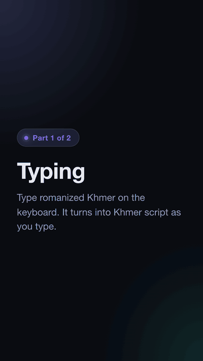

## ローマ字で打たれるクメール語

クメール語には独自の文字がありますが、多くのカンボジア人はチャットでクメール語をローマ字で打っています。クメール文字を入力できるスマホが少なかった頃に広まった習慣で、今もスマホやSNSではよく使われています。どのキーボードでもすぐ打てる一方、決まった綴りがありません。`knhom`、`khnhom`、`kyom`、それに `nh` だけでも、どれも ខ្ញុំ（「私」）を意味します。母音を省いたり、単語をつなげたり分けたり、英語を混ぜたりもします。`ot mean wifi te` は អត់មាន wifi ទេ（「Wi-Fi がない」）です。

こうして書かれたメッセージは読みにくく、単語分割から検索まで、クメール文字向けに作られたツールでは処理できません。主流の入力ツールも対応していません。Gboard にはラオ語やシンハラ語の翻字レイアウトはありますが、クメール語にはありません。

ローマ字表記のクメール語をクメール文字に変換できれば、使い道は二つあります。キーボードの中では、いつも通り打った文字をオフラインで、数ミリ秒でクメール文字にできます。キーボードの外では、ほかの人から届いたローマ字のメッセージをクメール文字で読めます。Samdei Type は、一つの小さなモデルでその両方をこなします。

<figure class="phone">
  
  <figcaption>Samdei Type Mini が、一つのメッセージを打つときにも、友だちからローマ字で届いたときにも変換します。表示されている変換はすべて、公開モデルの実際の出力です。</figcaption>
</figure>

## アイデア：「何が書かれているか」と「どう綴られるか」を分ける

変換を学習するには、ローマ字表記とクメール文字のペアが必要です。クメール文字のテキスト自体はたくさんあるのに、このペアはほとんどありません。既存のオープンなモデルは、綴りを主に一つの情報源（単語リストか、ルールベースの生成器）から学んでいて、その情報源の癖をそのまま受け継いでいます。

そこで、学習ペアを二つに分けて考えました。クメール文字の側、つまり*何が書かれているか*は、常に実在の文です。だから正解は作り方からして正しくなります。ローマ字の側、つまり*どう綴られるか*は、それぞれ別の偏りを持つ、小さくて不完全な複数の情報源から作ります。こうすると、モデルが一つの情報源の癖だけを覚えることがありません。たとえば ខ្ញុំចង់ទៅផ្សារ（「市場に行きたい」）という一文は、情報源によってこう綴られます。

| ローマ字の綴り | 情報源 |
| --- | --- |
| `knhom jong tou bsa` | ペルソナ生成器（丁寧に打つ人） |
| `khnhom chong tov phsear` | 公開単語リストから抽出した綴り表 |
| `kyom jong tow phsar` | ペルソナ生成器（いろいろな癖が混ざる人） |
| `nh jg tv psa` | ペルソナ生成器（省略して打つ人） |

情報源は次のとおりです。

- 4種類の打ち方のペルソナで綴り、母音の脱落・単語の連結・タイプミスなどのノイズを加えるルールベースの生成器
- 公開されているローマ字クメール語の単語リストから抽出した綴り表
- 実在の文を LLM（ローカルで動かした Gemma 4）にローマ字化させたもの
- くだけたチャット向けの省略形（`tov` → `tv`）や文字の伸ばし（`tovvv`）

## 学習：広いところから具体的なところへ

小さな文字レベルの Transformer を、まず主に生成器で作ったペアで事前学習します（Base は 1,280 万ペア、Mini は 650 万ペア）。そのあと二つの短い段階で、ほかの情報源を取り入れます。最初はチャットらしいペア、次にくだけた文体です。事前学習で単語を覚え、チャットらしいペアの段階で文全体を扱えるようになります。学習時間はノートPCの GPU 1枚で、Mini が約3時間、Base が約6時間でした。

デコード時には、ビームサーチの候補を単語言語モデルでリランキングします。Base ではさらに、文字言語モデルと、候補が入力をすべて説明できているかを確かめる逆方向のモデルも使います。

## 日常メッセージのベンチマーク

日常のローマ字メッセージで評価できる公開テストセットはありませんでした。既存のオープンなモデルは自分の学習データの一部で評価されていて、実際のチャットを使ったテストも、知る限り40文に満たないものでした。そこで **Samdei Type Bench** を作りました。場面を設計した日常メッセージと単語 2,155 件で、多くは LLM の下書きをネイティブスピーカーが確認したものです（確認してくれた皆さんに感謝します）。どの Samdei Type モデルも、このベンチマークで学習・選択・調整はしていません。

このベンチマークで、どちらのモデルも既存の最良のオープンモデルを上回りました。文字誤り率（CER）は低いほど良い指標です。

| システム | パラメータ数 | CER | 完全一致 |
| --- | --- | --- | --- |
| **Samdei Type Base** | 18.2M | **0.052** | **30%** |
| **Samdei Type Mini** | 7.1M | 0.058 | 24% |
| Akkhara-mini（6語ずつ） | 17.8M | 0.066 | 23% |
| AkaraAlpha | 0.08M | 0.281 | 2% |

Mini は速さも十分です。int8 ONNX にして Apple M5 Pro の CPU 1スレッドで動かすと、1入力あたり約5ミリ秒、リランキング込みでも1キー入力あたり5.7ミリ秒です。

## 公開したもの

すべて [Hugging Face のコレクション](https://huggingface.co/collections/samdei/samdei-type-romanized-khmer-khmer-script)にまとめて公開し、推論コードは [GitHub](https://github.com/Samdei-Labs/samdei-type) に置いています。

| 公開物 | 内容 | ライセンス |
| --- | --- | --- |
| [samdei-type-mini](https://huggingface.co/samdei/samdei-type-mini) | 端末上で動くモデル：int8 ONNX で 7 MiB、ほかに 1.2 MiB の単語言語モデル | Apache-2.0 |
| [samdei-type-base](https://huggingface.co/samdei/samdei-type-base) | 最も精度の高いオープンモデルと、そのリランキング用モデル | Apache-2.0 |
| [mini-pretrained](https://huggingface.co/samdei/samdei-type-mini-pretrained)、[base-pretrained](https://huggingface.co/samdei/samdei-type-base-pretrained) | 事前学習済みチェックポイント（自分用の変換器のファインチューニングに） | Apache-2.0 |
| [samdei-type-bench](https://huggingface.co/datasets/samdei/samdei-type-bench) | Samdei Type Bench（クメール文字は人手で確認済み） | CC BY 4.0 |
| [pretraining-data](https://huggingface.co/datasets/samdei/samdei-type-pretraining-data)、[finetuning-data](https://huggingface.co/datasets/samdei/samdei-type-finetuning-data) | 各段階で実際に使った学習ペア | CC BY-SA 4.0 |
| [samdei-type-resources](https://huggingface.co/datasets/samdei/samdei-type-resources) | LLM が書いたチャット文、抽出した綴り表、語彙リスト | ファイルごと |

モデルは `transformers` ライブラリだけで読み込めます。最高の精度で使うには、リランキングを加える `samdei-type` パッケージを使います。

```bash
pip install "samdei-type[deploy]"
samdei-type "knhom jong tov phsar"    # ខ្ញុំចង់ទៅផ្សារ
```

手法とすべての数値は[技術レポート](https://github.com/Samdei-Labs/samdei-type/blob/main/paper/samdei-type.pdf)に、リリースの紹介は [Hugging Face の記事](https://huggingface.co/blog/mengsay/samdei-type)（英語）にまとめています。ベンチマークもデータも学習レシピも公開しているので、ローマ字表記のクメール語、そしてクメール語の言語技術全般に取り組む人に、ぜひ使って、発展させて、改良してもらえたらうれしいです。

## 限界

- 学習で見たローマ字入力はすべて合成データです。実際の入力は評価にしか登場しません。
- 次の単語より広い文脈が必要な同音語は、まだ苦手です。ដើរ / ដែរ（`der`）、ដឹក / ដែក / ដេក（`dek`）など。
- 英語のまま打たれた借用語（ឆែក の意味の `check` など）は英語のまま残ります。
- クメール文字からローマ字への変換はしません。人名の公式なローマ字表記にも向いていません。

## 名前について

Samdei（សំដី）は「話す言葉」という意味です。このプロジェクトを公開しているチーム、Samdei Labs の名前でもあります。

## 引用

Samdei Type を使う場合は、技術レポートを引用してください。

```bibtex
@misc{samdei-type-2026,
  title  = {Samdei Type: Separating What Is Written from How It Is Spelled for Romanized Khmer Transliteration},
  author = {Mengsay Loem},
  year   = {2026},
  note   = {Technical report},
  url    = {https://github.com/Samdei-Labs/samdei-type/blob/main/paper/samdei-type.pdf}
}
```
